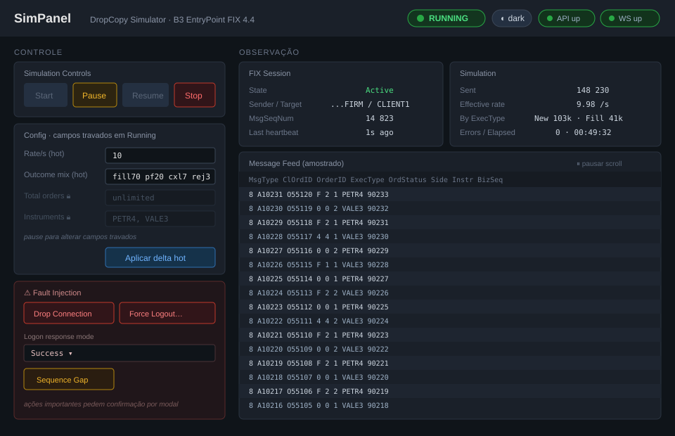
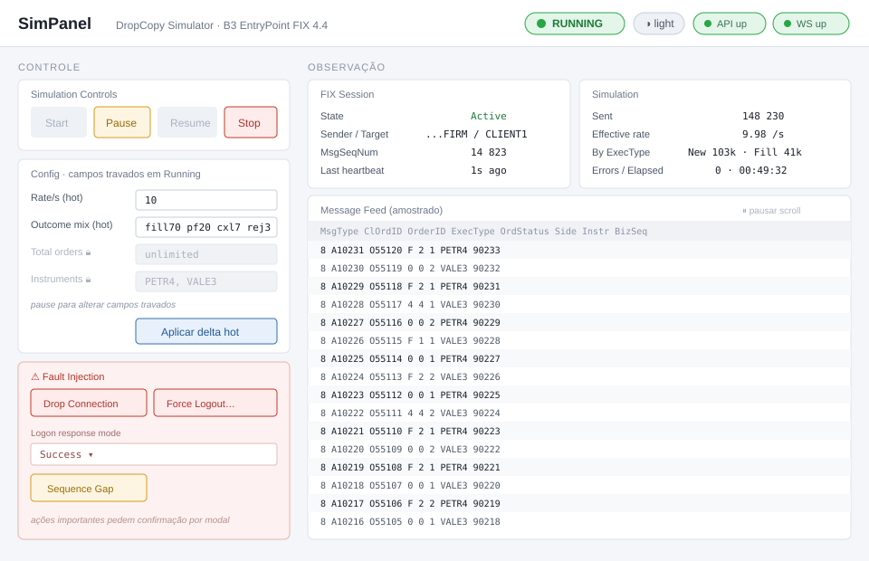

# DropCopy Simulator

Simulador do gateway FIX 4.4 (B3 EntryPoint) para testar o NexusRouter sem depender da B3.

É composto por duas pilhas independentes, ambas sob `sim/` e **completamente isoladas** do
NexusRouter (remover `sim/` não altera a build principal nem a CI):

- **`backend/`** — `DropCopySim.Host`: acceptor FIX (TCP), API de controle (Minimal API) e WebSocket
  de telemetria. Lógica de protocolo e geração em `DropCopySim.Core`.
- **`frontend/`** — `SimPanel`: painel web (React + Vite + TypeScript) para operar a simulação,
  editar a configuração, injetar falhas e acompanhar o fluxo em tempo real.

O operador liga/desliga o acceptor e inicia/pausa/para o fluxo pelo painel; o NexusRouter disca no
acceptor e ingere as mensagens como se fossem o DropCopy real da B3.

---

## Pré-requisitos

| Ferramenta | Versão | Usada por |
|------------|--------|-----------|
| .NET SDK   | 10.0   | backend   |
| Node.js    | 20 LTS ou superior | frontend |
| npm        | acompanha o Node | frontend |

O backend tem CPM e `Directory.Build.props` próprios dentro de `sim/backend/`, então não herda nada
da raiz do repositório.

---

## Como rodar

O backend e o frontend sobem separadamente, em dois terminais. Suba o backend primeiro — o painel
depende da API e do WebSocket.

### 1. Backend (SimCore)

```bash
# a partir da raiz do repositório
dotnet run --project sim/backend/src/DropCopySim.Host
```

Ao subir, o processo expõe:

- **Acceptor FIX:** `0.0.0.0:9876` (o NexusRouter disca aqui)
- **API de controle (HTTP):** `http://localhost:8099`
- **WebSocket de telemetria:** `ws://localhost:8099/v1/ws`

Esses valores vêm de `appsettings.json` (seção `DropCopySim`) e podem ser sobrescritos — ver
[Configuração](#configuração-do-backend).

### 2. Frontend (SimPanel)

```bash
cd sim/frontend
npm install
npm run dev
```

O Vite serve o painel em `http://localhost:5173`. A origem `http://localhost:5173` já está liberada
no CORS do backend por padrão (`DropCopySim:Control:AllowedOrigins`).

Scripts disponíveis no `sim/frontend`:

| Script | O que faz |
|--------|-----------|
| `npm run dev` | Servidor de desenvolvimento com HMR em `:5173` |
| `npm run build` | `tsc -b` + build de produção do Vite (saída em `dist/`) |
| `npm run preview` | Serve o build de produção localmente |
| `npm run typecheck` | Checagem de tipos sem emitir |

> As versões de dependências do `package.json` são **pinadas** (sem `^`/`~`), conforme política da
> organização. Ao adicionar pacotes, use versão exata (`npm install pacote@versao --save-exact`).

---

## Configuração

### Configuração do backend

Toda a configuração fica em `sim/backend/src/DropCopySim.Host/appsettings.json`, sob a chave
`DropCopySim`. Sobrescreva por `appsettings.Development.json`, variáveis de ambiente
(`DropCopySim__Acceptor__ListenPort=...`) ou argumentos de linha de comando.

| Chave | Default | Descrição |
|-------|---------|-----------|
| `Acceptor:ListenAddress` / `ListenPort` | `0.0.0.0` / `9876` | Endereço/porta do acceptor FIX |
| `Acceptor:SenderCompId` / `TargetCompId` | `ENTRYPOINT-FIRM-0001` / `CLIENT1` | CompIDs da sessão |
| `Acceptor:HeartBtIntSeconds` | `20` | Intervalo de heartbeat |
| `Acceptor:LogonMode` | `Success` | Modo de resposta ao Logon (`Success` / `InvalidCredentials` / `NotAuthorized`) |
| `Acceptor:Tls:Enabled` | `false` | Habilita TLS no acceptor |
| `Simulation:RatePerSecond` | `10` | Taxa de geração de mensagens |
| `Simulation:TotalOrders` | `0` | `0` = ilimitado; finito encerra a rodada no limite |
| `Simulation:Accounts` / `AccountSelection` | `ACC001..003` / `RoundRobin` | Contas e estratégia de seleção |
| `Simulation:Instruments` | `PETR4`, `VALE3` | Instrumentos sintéticos |
| `Simulation:Outcome` | fill 70 / partial 20 / cancel 7 / reject 3 | Proporção de desfechos (%) |
| `Control:HttpPort` | `8099` | Porta da API de controle + WS |
| `Control:AllowedOrigins` | `http://localhost:5173` | Origens liberadas no CORS |
| `Control:AuthTokenEnvVar` | `SIM_CONTROL_TOKEN` | Nome da env var do token (ver abaixo) |
| `Telemetry:MessageSampleMaxPerSecond` | `50` | Amostragem do feed de mensagens |

### Configuração do frontend

O frontend lê variáveis de ambiente do Vite (prefixo `VITE_`). Copie o exemplo e ajuste:

```bash
cd sim/frontend
cp .env.example .env.local   # no Windows/bash use: cp, ou copie manualmente
```

| Variável | Default | Descrição |
|----------|---------|-----------|
| `VITE_SIM_API` | `http://localhost:8099` | Base URL do SimCore (API + WebSocket) |
| `VITE_SIM_TOKEN` | *(vazio)* | Token bearer opcional, **somente em desenvolvimento** |

Quando `VITE_SIM_TOKEN` estiver vazio, o painel não envia o header `Authorization` — adequado ao modo
aberto de laboratório (ver abaixo).

---

## Layout do SimPanel

O SimPanel é uma ferramenta de operador: dashboard de página única, sem roteamento, com componentes
próprios (CSS Modules + variáveis de tema, sem biblioteca de UI). Topbar fixa com estado da
simulação, conectividade (API/WS) e alternância de tema; abaixo, duas colunas — **controle** à
esquerda (controles da rodada, formulário de config com política híbrida por estado, injeção de
falhas) e **observação** à direita (status da sessão FIX, status da simulação e o feed de mensagens
amostrado).

Ações importantes (`Stop` e todas as injeções de falha) passam por um **modal de confirmação**.
O painel suporta **tema claro e escuro**, com escuro como padrão e preferência persistida.

> Os mocks abaixo representam o layout alvo; não são a UI implementada. Detalhes em
> `.kiro/specs/dropcopy-simulator/design.md`, Seção 4.

### Tema escuro (padrão)



### Tema claro



---

## Testes

```bash
# testes do backend (unitários do Core + integração via cliente FIX mínimo)
dotnet test sim/backend/DropCopySimulator.slnx

# checagem de tipos do frontend
cd sim/frontend && npm run typecheck
```

Os testes de integração usam um cliente FIX 4.4 mínimo próprio; **não** há `ProjectReference` para
projetos do NexusRouter.

---

## API de controle — autenticação por token (opcional)

A API de controle e o WebSocket de telemetria suportam um token bearer **opcional**, controlado por
variável de ambiente. O comportamento é definido pela chave de configuração
`DropCopySim:Control:AuthTokenEnvVar` (default `SIM_CONTROL_TOKEN`), que nomeia **a variável de
ambiente** onde o token reside — nunca o valor do token.

### Modo protegido

Quando a variável de ambiente nomeada em `AuthTokenEnvVar` tiver um valor não vazio, toda requisição
precisa apresentar o token:

- **HTTP:** cabeçalho `Authorization: Bearer <token>`.
- **WebSocket (navegador):** como o handshake de upgrade não permite cabeçalhos customizados, o token
  pode vir no parâmetro de query de curta duração `access_token` da URL de upgrade.

Requisições sem token válido recebem `401 Unauthorized`. A comparação do token é feita em **tempo
constante** (`CryptographicOperations.FixedTimeEquals`), evitando vazamento por timing.

```bash
# Define o token apenas no ambiente do processo (nunca em arquivo versionado).
export SIM_CONTROL_TOKEN="um-segredo-forte"
dotnet run --project sim/backend/src/DropCopySim.Host

# Chamada autenticada:
curl -H "Authorization: Bearer um-segredo-forte" http://localhost:8099/
```

### Modo aberto de laboratório

Quando a variável de ambiente estiver **ausente ou vazia**, a API opera em **modo aberto de
laboratório**: nenhuma autenticação é exigida. Esse modo destina-se **exclusivamente a
desenvolvimento local**. Não exponha a API em rede não confiável sem um token configurado.

### Regras de segurança

- O token **nunca** é armazenado em configuração versionada, em URL persistida ou em log
  (FR-API-06, NFR-CFG-02).
- A configuração guarda apenas o **nome** da variável de ambiente, não o token.
- Para desenvolvimento local, prefira definir o token via variável de ambiente do shell ou
  `dotnet user-secrets`.
